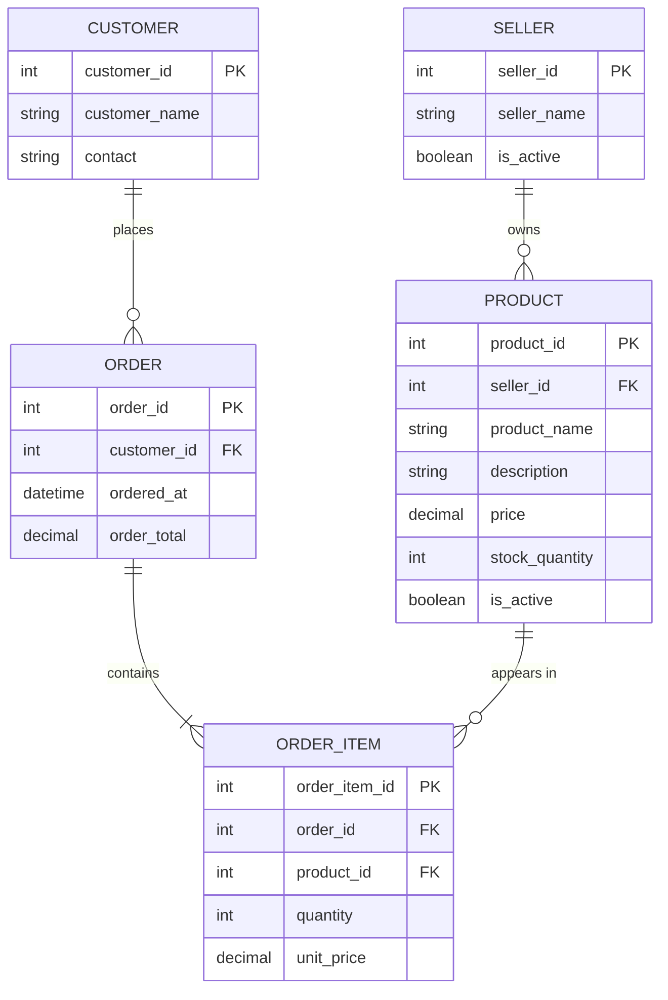

# Data Relationships (ERD)

This is the blueprint for the five marketplace tables. It follows the journeys in `docs/workflows.md` and the rules in `docs/business-rules.md`. No routes or tables are created by this document.



## Primary keys

- `seller.seller_id` uniquely identifies a seller.
- `product.product_id` uniquely identifies a product.
- `customer.customer_id` uniquely identifies a customer.
- `order.order_id` uniquely identifies an order.
- `order_item.order_item_id` uniquely identifies an order item.

## Foreign keys and one-to-many relationships

- `product.seller_id` points to `seller.seller_id`: one seller owns zero or many products; each product has exactly one seller. This supports BR-02 and BR-09.
- `order.customer_id` points to `customer.customer_id`: one customer places zero or many orders; each order belongs to exactly one customer. This supports BR-04.
- `order_item.order_id` points to `order.order_id`: one order contains one or many order items; each item belongs to exactly one order. This supports BR-10.
- `order_item.product_id` points to `product.product_id`: one product can appear in zero or many order items; each item references exactly one product. This supports BR-05, BR-08, and BR-11.

## Field notes

- `product.is_active` drives active-only browsing and ordering (BR-07). Deactivation changes this flag and does not delete the row (BR-08).
- `order_item.unit_price` is the price copied from `product.price` when the order is submitted; later product price changes must not rewrite it (BR-12).
- `order.order_total` must equal the sum of `unit_price * quantity` across its items at submission time.
- `product.price` must be greater than zero and `product.stock_quantity` must be a non-negative integer; each item `quantity` must be a positive integer not above the stock at submission time (BR-06, BR-11).
- Authentication fields, secrets, payment records, delivery tracking, and messaging are intentionally absent; this ERD covers only the in-scope marketplace data.

## Verification

Run:

```sh
grep -cE '^[[:space:]]+[a-z_]+ [a-z_]+ (PK|FK)' docs/data-model.md
grep -cE '^[[:space:]]+[A-Z_]+ \|\|--' docs/data-model.md
```

Expected counts: 9 primary/foreign key markers and 4 one-to-many relationships. Then read the entity blocks to confirm all five tables are present with understandable field names.

## Review pack cross-check

This document is part of the Sprint 1 review pack: [sprint-1-review.md](./sprint-1-review.md). It stores the five in-scope tables with clear PK/FK links, uses `is_active` for product availability, and keeps `unit_price` as a server-copied snapshot so historical order totals stay correct.
